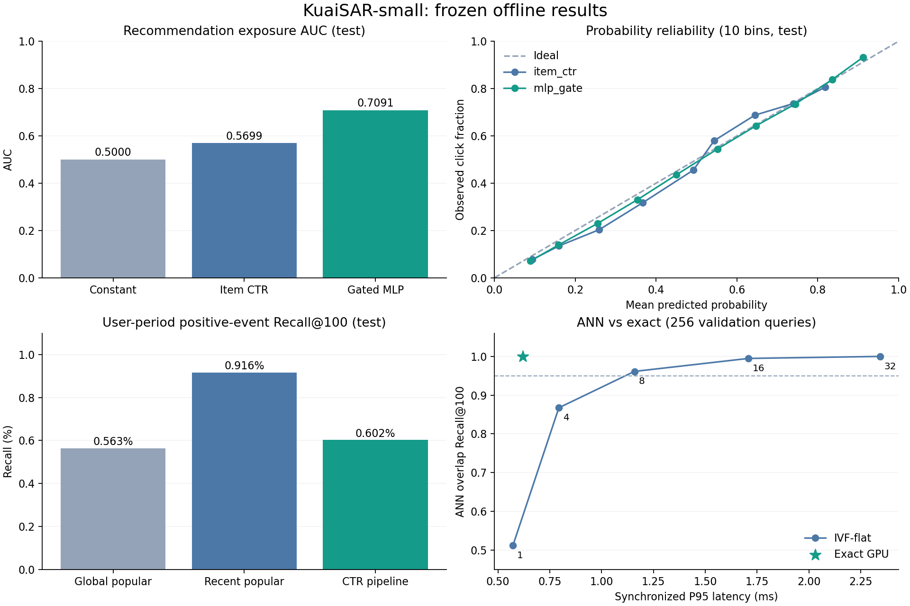

# KuaiSAR 离线系统最终报告

完成日期：2026-10-15。第一版完成数据、召回、精排、搜索排序、重排、效率实验、冻结测试和本地推理闭环。核心结果文件：`experiments/final_test/metrics.json`；独立复核：同目录 `audit.json`；冻结记录：`freeze.json`。

## 1. 最终测试结果

推荐测试保留 1,015,181 条曝光记录，其中 494,875 条 click=1。没有额外随机负采样。

| 推荐 CTR 方法 | AUC | 用户 GAUC | LogLoss | Brier | ECE，10 等宽桶 |
| --- | ---: | ---: | ---: | ---: | ---: |
| 训练点击率常数 | 0.500000 | 0.500000 | 0.693023 | 0.249938 | 0.009732 |
| 平滑物品点击率 | 0.569893 | 0.541629 | 0.682613 | 0.244871 | 0.036530 |
| 冻结门控 MLP | 0.709079 | 0.598855 | 0.622622 | 0.216827 | 0.013216 |

常数概率的 ECE 可以较低，但没有排序能力；因此不能只用 ECE 判断模型。GAUC 按用户分组，以有效组曝光行数加权，排除单一标签组，覆盖行数与组数随结果一同记录。

| 推荐列表方法 | 命中正事件@100 | 事件 Recall@100 | 用户周期观察正例 NDCG@10 |
| --- | ---: | ---: | ---: |
| 全时热门 | 2,785 | 0.5628% | 0.006104 |
| 冻结默认：训练末日热门 | 4,533 | 0.9160% | 0.006361 |
| 多路候选 + CTR 精排，类别惩罚 0 | 2,979 | 0.6020% | 0.004173 |

列表方案在 9,657 位测试用户上评测。每位用户使用训练截止时的一份固定列表，整个测试期点击作为相关物品；不是实际请求级 CTR 或 NDCG，也没有为未曝光候选生成负标签。Recall 按正事件计数，重复 user-item 点击保留。测试期有大量新物品，静态训练库存储的候选天然存在覆盖上限，绝对 Recall 较低。

搜索测试保留 125,577 条结果记录、10,829 个会话，其中 5,886 个含点击。

| 搜索方法 | AUC | 会话 GAUC | LogLoss | 正点击会话 NDCG@10 | 全会话 NDCG@10 | 正点击会话 MRR@10 |
| --- | ---: | ---: | ---: | ---: | ---: | ---: |
| 常数概率，物品 ID 打破并列 | 0.500000 | 0.500000 | 0.343172 | 0.459557 | 0.249788 | 0.385310 |
| 冻结结构化特征 HGB | 0.669159 | 0.541924 | 0.323656 | 0.505007 | 0.274492 | 0.447225 |

搜索在保留后的实际会话候选内排序，二值相关性为 click_cnt>0。常数分数基线并不是原系统排序：并列统一按 item_id 升序。没有做语义关键词与文案匹配，查询只使用长度、来源等请求结构信息。

## 2. 数据处理

官方 KuaiSAR-small：MD5 `daea8cbf605db6bd5841740f0e4a12d9`，大小 488,077,651 字节。原始 ZIP 与旧 partial 都保留，partial 不参与任何计算。

原始记录共 10,664,332 条：推荐 7,493,101、搜索 3,171,231；两场景各 25,877 个用户。全量核验毫秒时间戳与 UTC+8 文本时间对应关系一致。物品表 4,157,218 个唯一 ID，无重复物品键。

搜索中排除 720 条重复源记录、4,410 条歧义事件键记录、95 条不一致会话记录。4 个异常会话实际是关键词不一致；记录仍在 events 表，通过 exclusion 标记隔离。所有与这些记录有关的会话指标均是在处理后的候选列表上评测，不能声称复现了原系统完整结果页。

推荐物品特征覆盖完整；搜索存在 132,869 条原始交互缺少物品特征，保留并使用未知类别，不 inner join 删除。23 个类型异常值在源字段中已存在，保留 raw_type，模型类型归 UNKNOWN。11,901 个 1970 上传日期不作为真实新鲜度。

共享北京时间切分：train `< 2023-05-29 00:00`，valid `[05-29 00:00,05-30 00:00)`，test `>= 05-30 00:00`。不随机拆分或拆开同一搜索会话。

## 3. 特征与训练

推荐 CTR 使用 20 个特征：用户、物品、类别、用户类别的平滑点击率与计数，长期类别占比、已见标志、小时/星期周期，以及短期搜索点击类别计数、占比和可用标志。

训练样本的统计来自此前完整自然日，当前日期所有曝光完成特征生成后才更新计数。搜索短期信号使用前一完整自然日的已点击且类别已知物品。验证和测试固定训练截止状态；测试不利用验证行为更新特征。物品类别和类型按静态属性假设使用，数据没有其特征快照时间。

CTR 训练从推荐 train 均匀无放回抽取 1,000,000 条曝光，保留原类比例；同一抽样对比全部候选模型。搜索也均匀抽取 1,000,000 条搜索训练记录训练 HGB。随机种子 2026。

| 推荐验证模型 | AUC | GAUC | LogLoss |
| --- | ---: | ---: | ---: |
| SGD LR，迭代预算受限 | 0.694641 | 0.590658 | 0.636031 |
| HGB：推荐统计 | 0.711325 | 0.603784 | 0.622827 |
| HGB：推荐 + 搜索统计 | 0.711364 | 0.603787 | 0.622805 |
| MLP：直接拼接 | 0.712720 | 0.605186 | 0.619851 |
| MLP：双通道门控 | 0.712799 | 0.605586 | 0.619644 |

门控模型：推荐 16 维输入经 64→32 分支，搜索 4 维输入经 32 维分支，sigmoid 门控融合；无搜索时严格置零搜索贡献。MLP 固定训练 5 轮，批大小 4096，Adam(lr=0.001)，用验证最低 LogLoss、AUC 打破并列选择最终模型。

搜索信号的增益很小，门控与拼接接近；当前不支持“搜索迁移显著改善推荐”这一主张。测试仅报告已冻结的模型，不基于测试重选拼接模型或搜索开关。

## 4. 召回、融合、重排的负面结论

ItemCF 截断版、全历史共现版、ID 双塔、历史属性双塔均已实现与验证，详细消融见单项报告。双塔使用批内对比损失，不能将其分数视为点击概率。双塔初版有大量热门兜底命中，因此报告中单列了已知/冷用户组。

多路来源为全时热门 Top200、训练末日热门 Top200、历史属性双塔 Top100；融合包括不同 RRF 权重、近期/长期配额、上限 300 候选的 CTR 精排，以及类别重复惩罚 0/0.01/0.03。所有参数在验证集上比较。

验证中近期热门 Recall@100=1.6536%，超过所有现有融合与精排方案，故冻结为默认推荐。完整链路另存为实验接口。类别惩罚能提高多样性，但验证 NDCG 降低，冻结精排实验的惩罚系数为 0。

曝光 CTR 模型的 AUC 改善并不保证全库召回列表质量改善：两者候选分布和优化目标不同，列表又在整个用户周期上评测。这是当前离线实验的重要边界，不将分类指标归因成端到端收益。

## 5. 近似检索与成本

自实现 IVF-flat 使用冻结双塔的 951,625 个 32 维向量、64 个粗聚类；在前 256 位已有训练点击的验证用户上比较精确 Top100 重合率。它是 ANN 相对精确检索的 Recall，不是推荐任务 Recall。

| nprobe | ANN Recall@100 对精确结果 | P95，同步逐查询 ms |
| --- | ---: | ---: |
| 1 | 0.5121 | 0.5724 |
| 4 | 0.8674 | 0.7939 |
| 8 | 0.9612 | 1.1583 |
| 16 | 0.9947 | 1.7074 |
| 32 | 0.9999 | 2.3433 |
| 精确 GPU | 1.0000 | 0.6189 |

本机实现中满足 95% 重合率的 IVF 没有比精确 GPU 更快，保留精确后端。这不意味着优化的 FAISS 或其他硬件上近似检索没有优势。索引压缩文件约 3.12 MB，向量另占约 121.81 MB，两者不能混作总内存。

这里只给本机计算实验，没有线上网络、QPS、生产服务压测或真实 A/B。

## 6. 冻结与核验

在首次生成 test 特征与打分前写入 freeze.json。冻结时间、验证选型、代码和选中模型/状态 SHA256 都有记录。独立复核确认 1,015,181 条测试 CTR 概率的 AUC/LogLoss，checkpoint 重新加载后 4,096 条预测误差在 1e-6 内；三套测试候选均覆盖完整 9,657 用户、每人 100 个无重复候选，独立重算命中数与报告一致。

29 项单元测试通过。完成本地 best_recall 与 full_pipeline CLI 演示；未对外部署或上传数据。训练日志曾发生汇总序列化错误，使用已保存预测恢复，未借此重选模型；环境警告和恢复说明见 ENVIRONMENT.md。

## 7. 可用与未验收内容

当前可用于个人项目展示：可复核数据处理、训练与离线评测、消融、概率校准、召回融合、搜索会话排序、重排取舍、ANN 对比和本地 CLI。

尚不具备：在线实验收益、生产级服务、语义搜索、新物品动态全库、时点准确的全量内容快照、无偏曝光估计、多种子最终结论。旧计划中的 DeepFM/DCN/DIN、FastAPI、Docker、作者热度和长尾约束未全部实现，不能写入已完成能力。没有继续在最终测试集上反复试参数。
